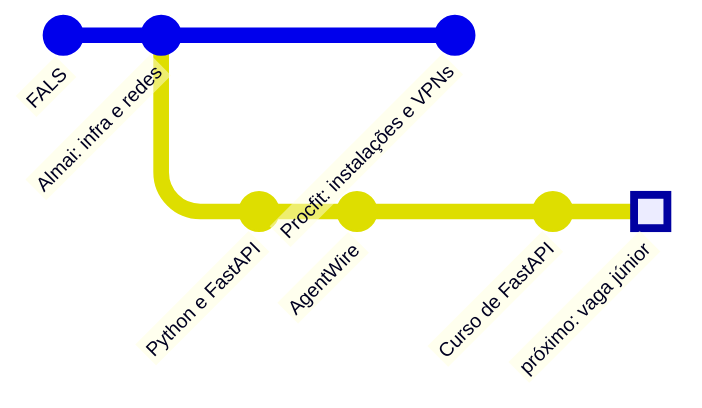
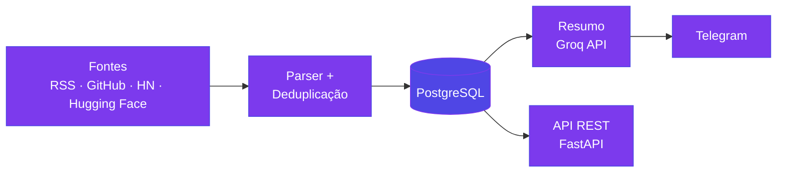
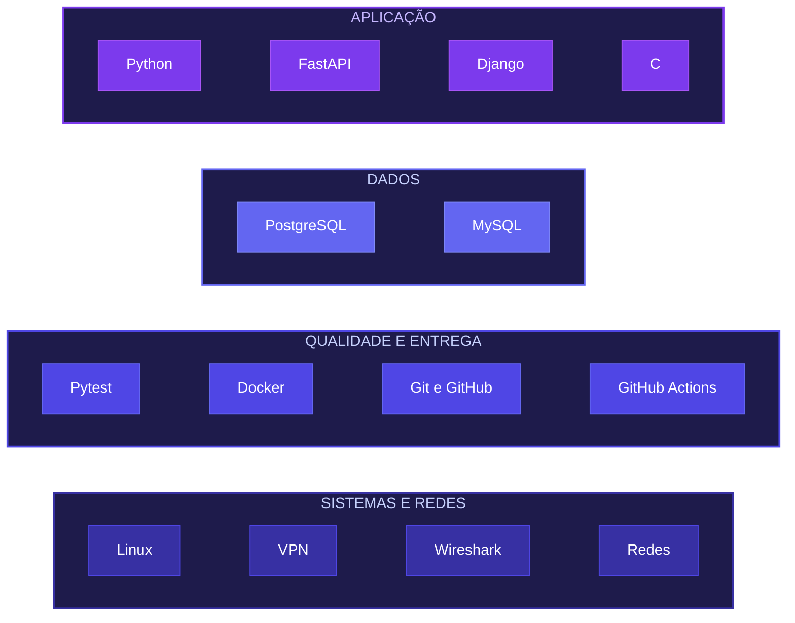

<div align="center">


[LinkedIn](https://www.linkedin.com/in/rafael-maia-508554232) · [GitHub](https://github.com/rafaelmaia-dev) · [AgentWire](https://github.com/rafaelmaia-dev/bot_noticias_ia)

</div>

```bash
$ systemctl status rafael

● rafael.service - desenvolvedor back-end em formação
     Loaded: loaded (FALS · Sistemas de Informação · 6º sem. · dez/2027)
     Active: active (running) · aberto a estágio ou vaga júnior
   Main PID: Procfit · Auxiliar de Instalação (PDV, pré-venda e VPNs)
      Tasks: 1 em desenvolvimento (AgentWire)
     Memory: Python · FastAPI · PostgreSQL · Docker
```

## Sobre

Sou estudante de Sistemas de Informação (6º semestre, FALS) e atuo como **Auxiliar de Instalação na Procfit**, no time de instalações de PDV, pré-venda e VPNs. Antes, fui estagiário de Infraestrutura no Instituto Almai. Foi nesses lugares que aprendi a olhar para o outro lado do software: **onde ele é instalado, em que rede ele roda e o que acontece quando algo para de funcionar.**

Agora levo essa base para o back-end. Trabalho com **Python (FastAPI e Django)**, bancos relacionais (**PostgreSQL e MySQL**) e **Docker, Git e GitHub Actions**, e construo o **AgentWire**, um bot que acompanha as novidades dos agentes de IA.

> [!IMPORTANT]
> **Aberto a oportunidades:** busco estágio ou vaga júnior em desenvolvimento back-end.

## Do cabo ao código

Meu caminho, no formato que eu mais gosto de ler: um `git log`.



## Projeto em destaque: AgentWire

> Bot no Telegram que mantém devs e vibe coders por dentro das novidades dos agentes de IA.


[](https://github.com/rafaelmaia-dev/bot_noticias_ia)

**O problema:** as novidades dos agentes de código (Claude Code, Codex, DeepSeek e outros) saem em blogs, repositórios e redes sociais, e acompanhar tudo toma tempo. O AgentWire coleta, resume e entrega no Telegram, com o link da fonte.

- **Pipeline determinístico.** Cada etapa tem entrada e saída bem definidas, e o LLM é usado só para resumir. Não é um agente de IA: é um sistema auditável *sobre* agentes.
- **API REST (FastAPI) e worker separados**, sobre o mesmo PostgreSQL.
- **Testes automatizados e de regressão**, e Docker para rodar na sua própria máquina.
- Desenvolvido com apoio do Antigravity.



<sub>As fontes além de RSS fazem parte do roadmap do projeto.</sub>

## Stack

Do app até a rede: as camadas por onde o meu código passa.



Desenvolvo com apoio do **Antigravity** e do **GitHub Copilot**.

## Aprofundando agora

- [x] Curso de FastAPI: APIs Modernas e Assíncronas com Python (nov/2026)
- [ ] SQLAlchemy assíncrono e Alembic
- [ ] Testes automatizados e de regressão com Pytest
- [ ] CI/CD com GitHub Actions
- [ ] Concluir o pipeline principal do AgentWire

## Outros projetos

| 🔌 **API Google** | 🧮 **Calculadora** |
|:---|:---|
| Script em Python que faz requisições HTTP (GET) para simular o consumo e o tratamento de respostas de APIs externas.<br><br><br><br>**Conceitos:** REST, HTTP e respostas de APIs<br><br>[Ver no GitHub →](https://github.com/rafaelmaia-dev/api-google) | Aplicação de terminal com menu interativo para operações matemáticas, com laços `while` para validação e controle de fluxo.<br><br><br><br>**Conceitos:** lógica de programação e validação de entrada<br><br>[Ver no GitHub →](https://github.com/rafaelmaia-dev/calculadora-while) |

## Formação

| Formação | Onde | Situação |
|:---|:---|:---|
| **Sistemas de Informação** | FALS · Faculdade do Litoral Sul Paulista |  6º semestre · dez/2027 |
| **FastAPI: APIs Modernas e Assíncronas com Python** | Udemy · Geek University · 12,5 h |  nov/2026 |
| **Redes de Computadores com Wireshark** | Udemy | curso extra |
| **Git e GitHub** | Udemy | curso extra |
| **Inglês** | CNA Master in English | curso de idioma |

## Contato

> [!TIP]
> O jeito mais rápido de falar comigo é o LinkedIn. Se você é recrutador ou tech lead, me chame para conversar sobre vagas de back-end, infra ou sobre o AgentWire.

<div align="center">

[](https://www.linkedin.com/in/rafael-maia-508554232) [](https://github.com/rafaelmaia-dev)


</div>
