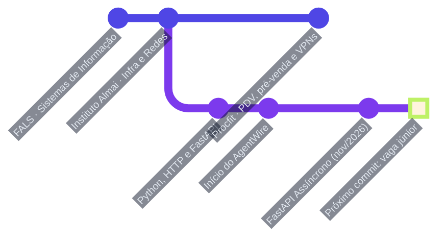
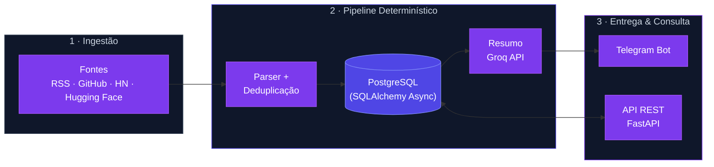
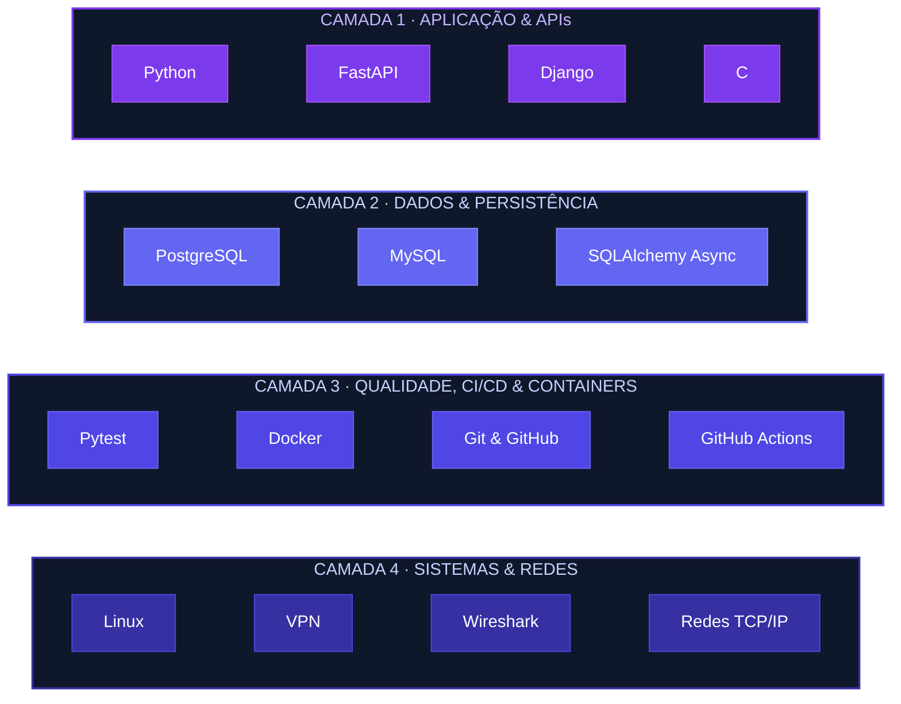

<div align="center">


[https://img.shields.io/badge/status-aberto%20a%20est%C3%A1gio%20ou%20j%C3%BAnior-2EA043?style=flat-square&labelColor=0F172A]
[https://img.shields.io/badge/foco-back--end%20%7C%20APIs%20%7C%20seguran%C3%A7a-7C3AED?style=flat-square&labelColor=0F172A]
[https://img.shields.io/badge/base-Brasil-4F46E5?style=flat-square&labelColor=0F172A]

<br/>

[[https://img.shields.io/badge/LinkedIn-0A66C2?style=for-the-badge&logo=linkedin&logoColor=white]](https://www.linkedin.com/in/rafael-maia-508554232)
[[https://img.shields.io/badge/GitHub-181717?style=for-the-badge&logo=github&logoColor=white]](https://github.com/rafaelmaia-dev)
[[https://img.shields.io/badge/Projeto%20Principal-AgentWire-7C3AED?style=for-the-badge&logo=telegram&logoColor=white]](https://github.com/rafaelmaia-dev/bot_noticias_ia)

</div>

```bash
$ systemctl status rafael.service --no-pager

● rafael.service — Desenvolvedor Back-end em formação
     Loaded: loaded (FALS · Sistemas de Informação · 6º sem. · previsão dez/2027)
     Active: active (running) — aberto a estágio ou vaga júnior em back-end
   Main PID: Procfit · Auxiliar de Instalação (PDV, pré-venda e VPNs)
      Tasks: 1 em produção local (AgentWire)
     Memory: Python · FastAPI · PostgreSQL · Docker · Linux · Redes

ago 2026 procfit[install]: início no time de instalações de PDV, pré-venda e VPNs
nov 2026 udemy[fastapi]:   concluído — APIs Modernas e Assíncronas com Python (12,5 h)
now      agentwire[pipe]:  pipeline determinístico de notícias sobre agentes de IA em evolução
```

<details>
<summary><code>$ curl -s https://github.com/rafaelmaia-dev | jq '.profile'</code> — ver resumo em JSON</summary>

```json
{
  "nome": "Rafael Maia",
  "foco": ["back-end", "APIs REST", "segurança", "pipelines determinísticos"],
  "atuacao_atual": "Auxiliar de Instalação na Procfit (PDV, pré-venda e VPNs)",
  "experiencia_anterior": "Estagiário de Infraestrutura no Instituto Almai",
  "stack_principal": ["Python", "FastAPI", "PostgreSQL", "SQLAlchemy Async", "Docker"],
  "projeto_em_destaque": "AgentWire (bot_noticias_ia)",
  "disponibilidade": "estágio ou vaga júnior em desenvolvimento back-end",
  "contato_rapido": "[https://www.linkedin.com/in/rafael-maia-508554232](https://www.linkedin.com/in/rafael-maia-508554232)"
}
```

</details>

## Sobre

Sou estudante de **Sistemas de Informação (6º semestre, FALS)** e atuo como **Auxiliar de Instalação na Procfit**, no time de instalações de PDV, pré-venda e VPNs. Antes, fui **estagiário de Infraestrutura no Instituto Almai**.

Foi na operação que aprendi a olhar para o outro lado do software: **onde ele é instalado, em que rede ele roda e o que acontece quando algo para de funcionar.** Hoje levo essa base para o desenvolvimento back-end com **Python (FastAPI e Django)**, bancos relacionais (**PostgreSQL e MySQL**), **Docker** e **GitHub Actions**.

| Infra → Código | Determinismo > Hype | Ambiente Reprodutível |
|:---|:---|:---|
| Experiência prática com redes, VPNs, Linux e troubleshooting antes de subir o primeiro endpoint. | Preferência por arquiteturas previsíveis, testáveis e fáceis de auditar em vez de "caixas-pretas". | Containers Docker, versionamento disciplinado e pipelines de CI/CD desde cedo nos projetos. |

> [!IMPORTANT]
> **Aberto a oportunidades:** busco estágio ou vaga júnior em desenvolvimento back-end (APIs, dados e sistemas).

## Do cabo ao código

Minha trajetória no formato que eu mais gosto de ler: um `git log`.



## Projeto em destaque — AgentWire

> Bot no Telegram que mantém devs e vibe coders por dentro das novidades dos agentes de código (Claude Code, Codex, DeepSeek e afins) — com foco técnico, financeiro e social.

[https://img.shields.io/badge/status-em%20desenvolvimento-F59E0B?style=flat-square&labelColor=0F172A]
[https://img.shields.io/github/last-commit/rafaelmaia-dev/bot_noticias_ia?style=flat-square&label=%C3%BAltimo%20commit&labelColor=0F172A&color=4F46E5]
[https://img.shields.io/badge/stack-FastAPI%20%C2%B7%20PostgreSQL%20%C2%B7%20Docker-7C3AED?style=flat-square&labelColor=0F172A]
[[https://img.shields.io/badge/ver%20reposit%C3%B3rio-181717?style=flat-square&logo=github&logoColor=white]](https://github.com/rafaelmaia-dev/bot_noticias_ia)

**O problema:** atualizações de agentes de código saem espalhadas em blogs, repositórios e redes sociais. O **AgentWire** coleta, deduplica, resume e entrega no Telegram com link para a fonte original — pronto para rodar localmente (self-hosted).



<sub>As fontes além de RSS (GitHub, HN e Hugging Face) fazem parte do roadmap do projeto.</sub>

### Decisões de Arquitetura (mini-ADR)

| Decisão | Alternativa descartada | Por quê |
|:---|:---|:---|
| **Pipeline determinístico** | Agente autônomo de IA | Cada etapa tem entrada e saída definidas; o LLM entra só para resumir. Mais previsível, barato e auditável. |
| **API REST e worker separados** | Processo monolítico único | Desacopla a coleta agendada (`APScheduler`) da exposição de dados (`FastAPI`) sobre o mesmo PostgreSQL. |
| **Polling (Hub API + RSS) no Hugging Face** | Webhooks públicos | Evita expor endpoints externos e mantém o projeto simples para instalação local / self-hosted. |
| **Docker + testes de regressão** | Setup manual na máquina | Garante reprodutibilidade de ambiente e validação contínua do comportamento do pipeline. |

<sub>Desenvolvido com apoio do **Antigravity**.</sub>

## Stack em camadas

Do código até o cabo: as camadas por onde as minhas aplicações passam.



<details>
<summary><strong>Ambiente de trabalho e ferramentas do dia a dia</strong></summary>

- **Sistema e banco local:** Zorin OS (Linux) · MySQL 8.0 no Ubuntu 24.04 · Docker
- **Editor e fluxo:** VSCode · DBeaver · Obsidian · terminal com JetBrains Mono
- **Apoio de IA no desenvolvimento:** Antigravity e GitHub Copilot
- **Estudos de segurança e qualidade:** JWT, OAuth2, SonarCloud e Trivy

</details>

## Em foco agora

- [x] **FastAPI: APIs Modernas e Assíncronas com Python** — concluído em nov/2026
- [ ] **SQLAlchemy 2.0 assíncrono + `asyncpg` + Alembic** — modelagem e migrações
- [ ] **Testes automatizados e de regressão com Pytest** — cobertura do pipeline
- [ ] **CI/CD com GitHub Actions** — automação de testes e checks de segurança
- [ ] **Pipeline principal do AgentWire** — entrega estável ponta a ponta

## Outros projetos

| 🔌 API Google | 🧮 Calculadora (CLI + CI/CD) |
|:---|:---|
| Script em Python que realiza requisições HTTP (`GET`) para exercitar consumo, parsing e tratamento de respostas de APIs externas.<br><br>[https://img.shields.io/badge/Python-3776AB?style=flat-square&logo=python&logoColor=white]<br><br>**Foco:** REST, HTTP e tratamento de respostas<br><br>[Ver repositório →](https://github.com/rafaelmaia-dev/api-google) | Aplicação de terminal com menu interativo para operações matemáticas, usando laços `while` para validação de entrada, controle de fluxo e pipeline de CI/CD.<br><br>[https://img.shields.io/badge/Python-3776AB?style=flat-square&logo=python&logoColor=white]<br><br>**Foco:** lógica, validação de entrada e automação<br><br>[Ver repositório →](https://github.com/rafaelmaia-dev/calculadora-while) |

## Formação

| Formação | Instituição | Status |
|:---|:---|:---|
| **Sistemas de Informação** | FALS · Faculdade do Litoral Sul Paulista | [https://img.shields.io/badge/em%20andamento-F59E0B?style=flat-square&labelColor=0F172A] 6º sem. · dez/2027 |
| **FastAPI: APIs Modernas e Assíncronas com Python** | Udemy · Geek University · 12,5 h | [https://img.shields.io/badge/conclu%C3%ADdo-2EA043?style=flat-square&labelColor=0F172A] nov/2026 |
| **Redes de Computadores com Wireshark** | Udemy | [https://img.shields.io/badge/curso%20extra-4F46E5?style=flat-square&labelColor=0F172A] |
| **Git e GitHub** | Udemy | [https://img.shields.io/badge/curso%20extra-4F46E5?style=flat-square&labelColor=0F172A] |
| **Inglês** | CNA Master in English | [https://img.shields.io/badge/idioma-7C3AED?style=flat-square&labelColor=0F172A] |

## Contato

> [!TIP]
> O caminho mais rápido para falar comigo é o **LinkedIn**. Se você é recrutador ou tech lead, pode chamar para conversar sobre vagas de estágio/júnior em back-end, infraestrutura ou sobre as decisões do AgentWire.

<div align="center">

[[https://img.shields.io/badge/Falar%20no%20LinkedIn-0A66C2?style=for-the-badge&logo=linkedin&logoColor=white]](https://www.linkedin.com/in/rafael-maia-508554232)
[[https://img.shields.io/badge/Explorar%20Reposit%C3%B3rios-181717?style=for-the-badge&logo=github&logoColor=white]](https://github.com/rafaelmaia-dev)


</div>
