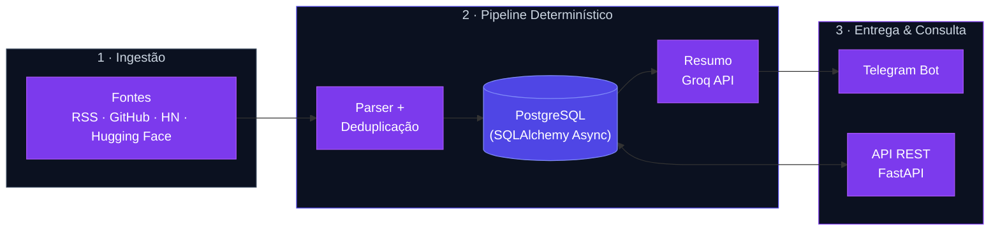
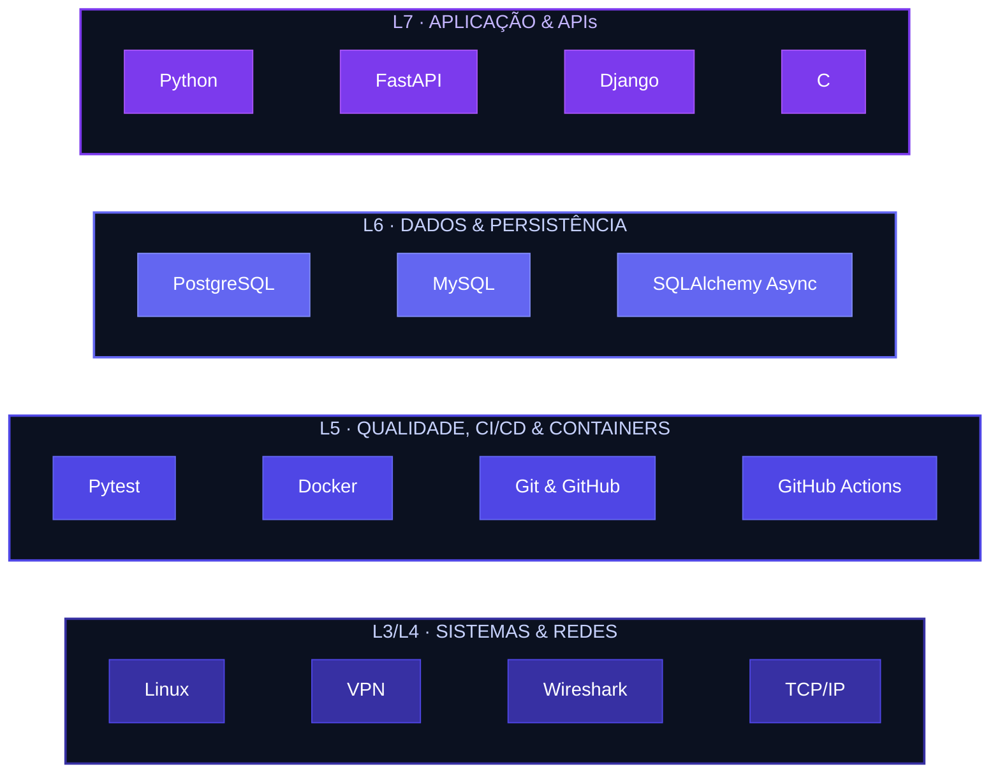
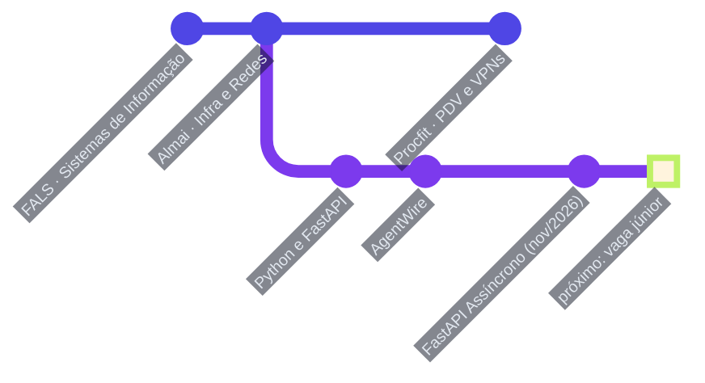

<div align="center">


[https://img.shields.io/badge/HTTP-200%20OK-2EA043?style=flat-square&labelColor=0B1120]
[https://img.shields.io/badge/vaga-est%C3%A1gio%20ou%20j%C3%BAnior%20back--end-7C3AED?style=flat-square&labelColor=0B1120]
[https://img.shields.io/badge/regi%C3%A3o-Brasil-4F46E5?style=flat-square&labelColor=0B1120]

[[https://img.shields.io/badge/LinkedIn-0A66C2?style=for-the-badge&logo=linkedin&logoColor=white]](https://www.linkedin.com/in/rafael-maia-508554232)
[[https://img.shields.io/badge/GitHub-181717?style=for-the-badge&logo=github&logoColor=white]](https://github.com/rafaelmaia-dev)
[[https://img.shields.io/badge/AgentWire-Reposit%C3%B3rio-7C3AED?style=for-the-badge&logo=telegram&logoColor=white]](https://github.com/rafaelmaia-dev/bot_noticias_ia)

</div>

```bash
$ traceroute -n career.rafaelmaia.dev
traceroute to back-end (estagio-ou-junior), 6 hops max

 1  fals.edu.br       [Sistemas de Informação · 6º sem. · dez/2027]   ok
 2  almai.infra       [Estágio de Infraestrutura · redes & suporte]   ok
 3  procfit.vpn       [Auxiliar de Instalação · PDV, pré-venda, VPN]  ok
 4  python.fastapi    [APIs assíncronas · PostgreSQL · Docker]        ok
 5  agentwire.local   [Pipeline determinístico de notícias de IA]     active
 6  sua-equipe.dev    [Estágio ou Dev Back-end Júnior]                waiting...
```

---

### [https://img.shields.io/badge/GET-2EA043?style=flat-square] `/v1/profile` — Do cabo ao código

A maioria aprende a subir uma API antes de entender a rede onde ela roda. Eu fiz o caminho inverso: comecei na infraestrutura (**Instituto Almai**) e hoje atuo na **Procfit** com instalações de PDV, pré-venda e VPNs — lidando todos os dias com **onde o software é instalado, em que rede ele trafega e o que acontece quando algo cai.**

Hoje levo essa mentalidade operacional para o back-end com **Python (FastAPI e Django)**, **PostgreSQL/MySQL**, **Docker** e **GitHub Actions**.

| Princípio | Na prática |
|:---|:---|
| **Infra → Código** | Troubleshooting real de rede, VPNs e Linux antes de abrir o editor. |
| **Determinismo > Hype** | Prefiro pipelines previsíveis, testáveis e auditáveis a "caixas-pretas". |
| **Ambiente Reprodutível** | Docker, versionamento limpo e CI/CD desde os primeiros commits. |

<details>
<summary><code>Response 200 OK</code> — ver payload completo em JSON</summary>

```json
{
  "nome": "Rafael Maia",
  "curso": "Sistemas de Informação · FALS (6º semestre · previsão dez/2027)",
  "atuacao_atual": "Auxiliar de Instalação na Procfit (PDV, pré-venda e VPNs)",
  "experiencia_anterior": "Estagiário de Infraestrutura no Instituto Almai",
  "foco": ["back-end", "APIs REST", "segurança", "pipelines determinísticos"],
  "stack_principal": ["Python", "FastAPI", "PostgreSQL", "SQLAlchemy Async", "Docker"],
  "aberto_a": "estágio ou vaga júnior em desenvolvimento back-end"
}
```

</details>

---

### [https://img.shields.io/badge/GET-2EA043?style=flat-square] `/v1/projects/agentwire` — Projeto em destaque

> **AgentWire** — Bot no Telegram que mantém devs e vibe coders atualizados sobre agentes de código (Claude Code, Codex, DeepSeek e afins), cobrindo mudanças técnicas, financeiras e sociais.

[https://img.shields.io/badge/status-em%20desenvolvimento-F59E0B?style=flat-square&labelColor=0B1120]
[https://img.shields.io/github/last-commit/rafaelmaia-dev/bot_noticias_ia?style=flat-square&label=%C3%BAltimo%20commit&labelColor=0B1120&color=4F46E5]
[[https://img.shields.io/badge/ver%20c%C3%B3digo-181717?style=flat-square&logo=github&logoColor=white]](https://github.com/rafaelmaia-dev/bot_noticias_ia)



<sub>As fontes além de RSS (GitHub, HN e Hugging Face) fazem parte do roadmap. Desenvolvido com apoio do Antigravity.</sub>

#### ADR — Por que foi construído assim?

| Decisão | Descartado | Motivo |
|:---|:---|:---|
| **Pipeline determinístico** | Agente autônomo de IA | Entradas e saídas rígidas; o LLM entra só para resumir. Mais barato, testável e auditável. |
| **API (FastAPI) + Worker separados** | Processo monolítico | Desacopla a coleta agendada (`APScheduler`) da camada REST sobre o mesmo PostgreSQL. |
| **Polling (Hub API + RSS) no HF** | Webhooks públicos | Mantém o projeto simples para rodar local/self-hosted sem expor porta pública. |
| **Docker + testes de regressão** | Setup manual | Garante que o pipeline rode igual em qualquer máquina e pegue quebras cedo. |

---

### [https://img.shields.io/badge/GET-2EA043?style=flat-square] `/v1/stack?view=layers` — Do app até a rede



<details>
<summary><code>$ env | grep WORKSPACE</code> — sistema, ferramentas e estudos de segurança</summary>

- **OS & Banco local:** Zorin OS (Linux) · MySQL 8.0 no Ubuntu 24.04 · Docker
- **Setup:** VSCode · DBeaver · Obsidian · terminal com JetBrains Mono
- **Apoio de IA:** Antigravity · GitHub Copilot
- **Estudos de segurança & qualidade:** JWT · OAuth2 · SonarCloud · Trivy

</details>

---

### [https://img.shields.io/badge/GET-2EA043?style=flat-square] `/v1/changelog` — Trajetória e foco atual



- [x] **FastAPI: APIs Modernas e Assíncronas com Python** (Geek University · nov/2026)
- [ ] **SQLAlchemy 2.0 assíncrono + `asyncpg` + Alembic**
- [ ] **Testes automatizados e de regressão com Pytest**
- [ ] **CI/CD com GitHub Actions**
- [ ] **Fechar o pipeline principal do AgentWire**

---

### [https://img.shields.io/badge/GET-2EA043?style=flat-square] `/v1/repositories` & `/v1/education`

| Projeto | O que exercita | Link |
|:---|:---|:---|
| **🔌 API Google** | Requisições HTTP (`GET`), consumo e tratamento de respostas de APIs externas em Python. | [github.com/rafaelmaia-dev/api-google →](https://github.com/rafaelmaia-dev/api-google) |
| **🧮 Calculadora (CLI + CI/CD)** | Menu interativo em terminal com laços `while`, validação de entrada e automação de CI/CD. | [github.com/rafaelmaia-dev/calculadora-while →](https://github.com/rafaelmaia-dev/calculadora-while) |

<details>
<summary><strong>Ver formação e cursos concluídos</strong></summary>

| Formação | Instituição | Status |
|:---|:---|:---|
| **Sistemas de Informação** | FALS · Faculdade do Litoral Sul Paulista | [https://img.shields.io/badge/em%20andamento-F59E0B?style=flat-square&labelColor=0B1120] 6º sem. · dez/2027 |
| **FastAPI: APIs Modernas e Assíncronas com Python** | Udemy · Geek University · 12,5 h | [https://img.shields.io/badge/conclu%C3%ADdo-2EA043?style=flat-square&labelColor=0B1120] nov/2026 |
| **Redes de Computadores com Wireshark** | Udemy | [https://img.shields.io/badge/curso%20extra-4F46E5?style=flat-square&labelColor=0B1120] |
| **Git e GitHub** | Udemy | [https://img.shields.io/badge/curso%20extra-4F46E5?style=flat-square&labelColor=0B1120] |
| **Inglês** | CNA Master in English | [https://img.shields.io/badge/idioma-7C3AED?style=flat-square&labelColor=0B1120] |

</details>

---

### [https://img.shields.io/badge/POST-4F46E5?style=flat-square] `/v1/contact` — Vamos conversar

```bash
$ curl -X POST [https://linkedin.com/in/rafael-maia-508554232](https://linkedin.com/in/rafael-maia-508554232) \
  -d '{"assunto": "Vaga Back-end / Infra / AgentWire"}'

< HTTP/1.1 202 Accepted — resposta mais rápida pelo LinkedIn.
```

<div align="center">

[[https://img.shields.io/badge/Chamar%20no%20LinkedIn-0A66C2?style=for-the-badge&logo=linkedin&logoColor=white]](https://www.linkedin.com/in/rafael-maia-508554232)
[[https://img.shields.io/badge/Ver%20Reposit%C3%B3rios-181717?style=for-the-badge&logo=github&logoColor=white]](https://github.com/rafaelmaia-dev)


</div>
