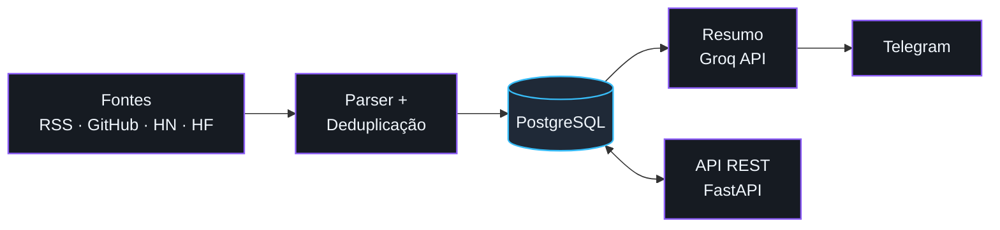
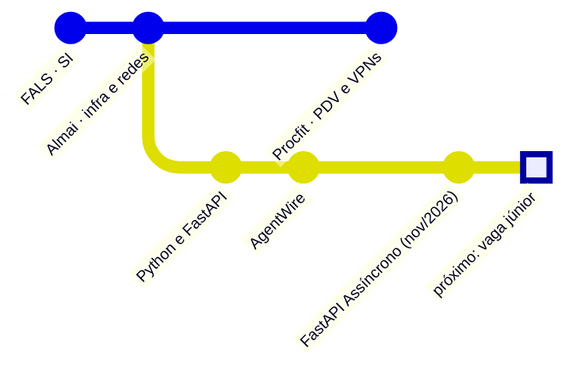

```text
        /\         rafa@zorin-os
       /  \        ─────────────────────────────────────
      / /\ \       nome      Rafael Maia
     / /  \ \      classe    Back-end (ex-cabo de rede)
    / /    \ \     guilda    Procfit · PDV, pré-venda e VPNs
   /_/      \_\    formação  Sistemas de Informação · FALS (6º sem.)
                   missão    estágio ou vaga júnior em back-end
                   sidequest Resident Evil 4 Remake
```

### Oi, eu sou o Rafa — back-end que sabe onde o código roda.

Antes de escrever meu primeiro endpoint, eu já estava puxando cabo, configurando VPN e descobrindo por que o sistema caiu na hora errada — primeiro como estagiário de infra no **Instituto Almai**, hoje no time de instalações da **Procfit**.

Agora eu fico do outro lado da tela: construindo APIs em **Python**, modelando banco em **PostgreSQL** e empacotando tudo em **Docker**, sem esquecer da rede onde o código vai parar.

[LinkedIn](https://www.linkedin.com/in/rafael-maia-508554232) · [AgentWire](https://github.com/rafaelmaia-dev/bot_noticias_ia) · [Repositórios](https://github.com/rafaelmaia-dev?tab=repositories)

<br/>

## O que eu tô construindo agora

### [AgentWire](https://github.com/rafaelmaia-dev/bot_noticias_ia) — radar de agentes de IA no Telegram

Todo dia sai uma novidade sobre Claude Code, Codex, DeepSeek e companhia — espalhada em blog, GitHub e rede social. O **AgentWire** coleta, filtra, resume e entrega direto no Telegram para devs e vibe coders, com link para a fonte e pronto para rodar na sua própria máquina.



<sub>Fontes além de RSS estão no roadmap · construído com apoio do Antigravity.</sub>

<details>
<summary><strong>Por que eu NÃO usei um agente de IA num bot sobre agentes de IA?</strong></summary>
<br/>

Porque nem todo problema pede um agente autônomo. No AgentWire, o pipeline é **100% determinístico**: cada etapa tem entrada e saída claras, a API (`FastAPI`) e o worker (`APScheduler`) rodam separados sobre o mesmo PostgreSQL, e o LLM entra só na hora de resumir. Para o Hugging Face, escolhi polling (Hub API + RSS) em vez de webhooks para ninguém precisar abrir porta pública só para rodar o bot localmente.

</details>

<br/>

## Loadout

| Equipado | Upando agora | Setup do dia a dia |
|:---|:---|:---|
| `Python` · `FastAPI` · `Django` · `C` | `SQLAlchemy 2.0 Async` + `Alembic` | **OS:** Zorin OS (Linux) |
| `PostgreSQL` · `MySQL` | `Pytest` (unitários e regressão) | **IDE:** VSCode · Antigravity · Copilot |
| `Docker` · `Git` · `GitHub Actions` | `JWT` · `OAuth2` | **Dados & Notas:** DBeaver · Obsidian |
| `Linux` · `VPN` · `Wireshark` · `TCP/IP` | `SonarCloud` · `Trivy` | **Fonte:** JetBrains Mono |

<br/>

## Do cabo ao código



<details>
<summary><strong>Outros projetos e cursos</strong></summary>
<br/>

- [**api-google**](https://github.com/rafaelmaia-dev/api-google) — consumo de API externa em Python com `GET` e tratamento de respostas HTTP.
- [**calculadora-while**](https://github.com/rafaelmaia-dev/calculadora-while) — CLI interativa em Python com validação de entrada e pipeline de CI/CD.
- **Sistemas de Informação** — FALS (6º semestre · previsão dez/2027)
- **FastAPI: APIs Modernas e Assíncronas com Python** — Geek University / Udemy (12,5 h · nov/2026)
- **Redes de Computadores com Wireshark** & **Git e GitHub** — Udemy
- **Inglês** — CNA Master in English

</details>

<br/>

## Vamos trocar uma ideia

O jeito mais rápido de me achar é no [**LinkedIn**](https://www.linkedin.com/in/rafael-maia-508554232). Se quiser falar sobre uma vaga de estágio/júnior em back-end, trocar ideia sobre o AgentWire ou discutir por que um cabo de rede mal crimpado derruba qualquer arquitetura bonita — só chamar.

<details>
<summary><sub>// chegou até o final?</sub></summary>

```text
"Stranger, stranger... now THAT'S a clean back-end."
```

</details>
