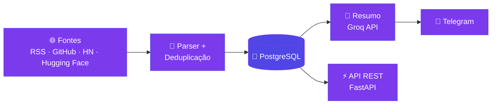

<div align="center">


<br/>


[**LinkedIn**](https://www.linkedin.com/in/rafael-maia-508554232) &nbsp;·&nbsp; [**GitHub**](https://github.com/rafaelmaia-dev) &nbsp;·&nbsp; [**AgentWire**](https://github.com/rafaelmaia-dev/bot_noticias_ia)

</div>

<br/>

Se este perfil fosse uma API, a resposta seria esta:

```http
GET /rafael

200 OK
```

```json
{
  "nome": "Rafael Maia",
  "papel": "desenvolvedor back-end em formação",
  "agora": {
    "trabalho": "Auxiliar de Instalação @ Procfit (PDV, pré-venda e VPNs)",
    "estudo": "Sistemas de Informação, FALS (6º semestre, conclusão em dez/2027)",
    "construindo": "AgentWire, um bot que acompanha as novidades dos agentes de IA"
  },
  "stack": ["Python", "FastAPI", "PostgreSQL", "Docker"],
  "diferencial": "vivência em redes, VPNs e instalação de sistemas: sei onde o código roda",
  "procurando": "estágio ou vaga júnior em desenvolvimento back-end"
}
```

<br/>

## 01 · Sobre

Sou estudante de Sistemas de Informação (6º semestre, FALS) e atuo como **Auxiliar de Instalação na Procfit**, no time de instalações de PDV, pré-venda e VPNs. Antes, fui estagiário de Infraestrutura no Instituto Almai. Foi nesses lugares que aprendi a olhar para o outro lado do software: **onde ele é instalado, em que rede ele roda e o que acontece quando algo para de funcionar.**

Agora levo essa base para o back-end. Trabalho com **Python (FastAPI e Django)**, bancos relacionais (**PostgreSQL e MySQL**) e **Docker, Git e GitHub Actions**, e construo o **AgentWire**, um bot que acompanha as novidades dos agentes de IA. Procuro uma oportunidade de **estágio ou vaga júnior em desenvolvimento back-end**.

| Período | Função | Onde | O que faço (ou fiz) |
|---|---|---|---|
| ago/2026 – atual | Auxiliar de Instalação | Procfit | Time de instalações: PDV, pré-venda e VPNs |
| nov/2025 – jul/2026 | Estagiário de Infraestrutura | Instituto Almai | Redes, configuração de ambientes e suporte técnico (N1 e N2) |

<br/>

## 02 · Projeto em destaque: AgentWire

> Bot no Telegram que mantém devs e vibe coders por dentro das novidades dos agentes de IA.


[](https://github.com/rafaelmaia-dev/bot_noticias_ia)

**O problema:** as novidades dos agentes de código (Claude Code, Codex, DeepSeek e outros) saem em blogs, repositórios e redes sociais, e acompanhar tudo toma tempo. O AgentWire coleta, resume e entrega no Telegram, com o link da fonte.

- **Pipeline determinístico.** Cada etapa tem entrada e saída bem definidas, e o LLM é usado só para resumir. Não é um agente de IA: é um sistema auditável *sobre* agentes.
- **API REST (FastAPI) e worker separados**, sobre o mesmo PostgreSQL.
- **Testes automatizados e de regressão**, e Docker para rodar na sua própria máquina.
- Desenvolvido com apoio do Antigravity.



<sub>As fontes além de RSS fazem parte do roadmap do projeto.</sub>

<br/>

## 03 · Stack

<table>
  <tr>
    <td><b>Linguagens</b></td>
    <td>
       Python &nbsp;&nbsp;
       C
    </td>
  </tr>
  <tr>
    <td><b>Frameworks</b></td>
    <td>
       FastAPI &nbsp;&nbsp;
       Django
    </td>
  </tr>
  <tr>
    <td><b>Dados</b></td>
    <td>
       PostgreSQL &nbsp;&nbsp;
       MySQL
    </td>
  </tr>
  <tr>
    <td><b>DevOps</b></td>
    <td>
       Docker &nbsp;&nbsp;
       Git &nbsp;&nbsp;
       GitHub &nbsp;&nbsp;
       GitHub Actions
    </td>
  </tr>
  <tr>
    <td><b>Sistemas e redes</b></td>
    <td>
       Linux &nbsp;&nbsp;
       Wireshark &nbsp;&nbsp;
      VPN &nbsp;&nbsp; Redes de computadores
    </td>
  </tr>
  <tr>
    <td><b>Testes</b></td>
    <td> Pytest</td>
  </tr>
  <tr>
    <td><b>Ferramentas de IA</b></td>
    <td>
       Antigravity &nbsp;&nbsp;
       GitHub Copilot
    </td>
  </tr>
</table>

Aprofundando agora: SQLAlchemy assíncrono e Alembic, testes com Pytest e CI/CD com GitHub Actions.

<br/>

## 04 · Outros projetos

| Projeto | O que faz | Tecnologia |
|---|---|---|
| [**API Google**](https://github.com/rafaelmaia-dev/api-google) | Script com requisição GET via link, simulando a integração com APIs externas | Python |
| [**Calculadora**](https://github.com/rafaelmaia-dev/calculadora-while) | Aplicação de terminal com menu interativo para operações aritméticas, usando `while` | Python |

<br/>

## 05 · Formação

- **FALS** (Faculdade do Litoral Sul Paulista): Sistemas de Informação, 6º semestre, conclusão em dez/2027
- **FastAPI: APIs Modernas e Assíncronas com Python**: Udemy, Geek University, 12,5 horas (concluído em nov/2026)
- **Redes de Computadores com Wireshark** e **Git e GitHub**: Udemy
- **Inglês**: CNA Master in English

<br/>

## 06 · Contato

Recrutadores e tech leads: o caminho mais rápido é o [**LinkedIn**](https://www.linkedin.com/in/rafael-maia-508554232). Também converso sobre back-end, infra e sobre o AgentWire por lá.

<br/>

<div align="center">
<sub>Escrevo código que sabe onde vai rodar.</sub>
</div>
