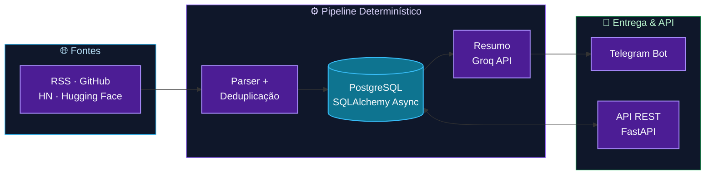
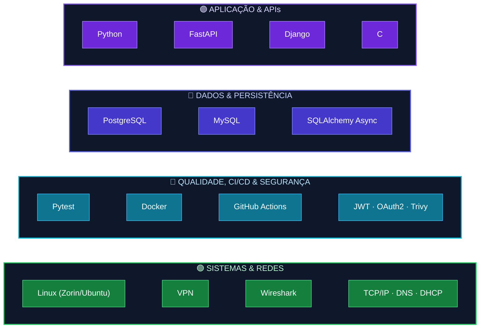
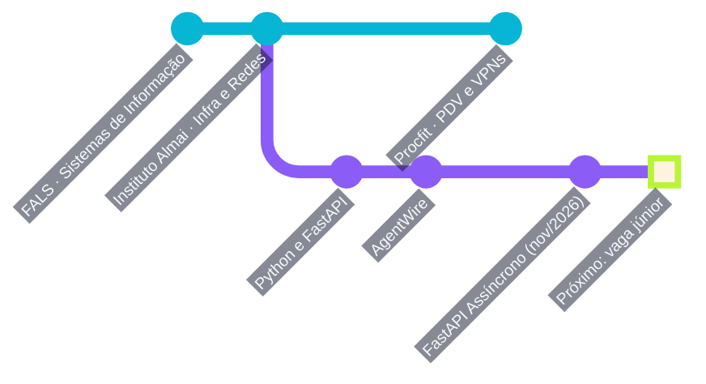

<div align="center">


<a href="https://github.com/rafaelmaia-dev">
  
</a>

<br/>

[https://img.shields.io/badge/status-aberto%20a%20est%C3%A1gio%20ou%20j%C3%BAnior-22C55E?style=for-the-badge&labelColor=0F172A]
[https://img.shields.io/badge/foco-Back--end%20%7C%20APIs%20%7C%20Seguran%C3%A7a-7C3AED?style=for-the-badge&labelColor=0F172A]
[https://img.shields.io/badge/Brasil-06B6D4?style=for-the-badge&logo=googlemaps&logoColor=white&labelColor=0F172A]

<br/>

[[https://img.shields.io/badge/LinkedIn-0A66C2?style=for-the-badge&logo=linkedin&logoColor=white]](https://www.linkedin.com/in/rafael-maia-508554232)
[[https://img.shields.io/badge/GitHub-181717?style=for-the-badge&logo=github&logoColor=white]](https://github.com/rafaelmaia-dev)
[[https://img.shields.io/badge/Projeto%20Destaque-AgentWire-8B5CF6?style=for-the-badge&logo=telegram&logoColor=white]](https://github.com/rafaelmaia-dev/bot_noticias_ia)

</div>

<br/>

## ⚡ Sobre mim

<table>
<tr>
<td width="54%" valign="top">

### Do cabo ao código

Antes de subir meu primeiro endpoint, eu já estava na linha de frente vendo **onde o software é instalado, em que rede ele roda e o que acontece quando algo cai**.

- **Hoje:** Auxiliar de Instalação na **Procfit**, no time de instalações de PDV, pré-venda e VPNs.
- **Antes:** Estagiário de Infraestrutura no **Instituto Almai** (redes, suporte, VoIP e sistemas).
- **Formação:** Sistemas de Informação na **FALS** (6º semestre · previsão dez/2027).
- **Direção:** Desenvolvimento **Back-end** com foco em APIs, bancos relacionais, containers e segurança.

> [!IMPORTANT]
> **Buscando oportunidade:** estágio ou vaga júnior em desenvolvimento back-end.

</td>
<td width="46%" valign="top">

```bash
$ systemctl status rafael.service

● rafael.service - Back-end Dev
   Loaded: FALS · SI (6º sem.)
   Active: active (running)
     Role: Procfit · PDV & VPNs
    Focus: APIs · Dados · Segurança
    Build: AgentWire (Telegram Bot)
       OS: Zorin OS · JetBrains Mono
    Games: Resident Evil 4 Remake
```

</td>
</tr>
</table>

<br/>

## 🚀 Projeto em Destaque — AgentWire

> **Bot no Telegram que mantém devs e vibe coders por dentro das novidades dos agentes de código** (Claude Code, Codex, DeepSeek, Anthropic, OpenAI e afins), cobrindo mudanças técnicas, financeiras e sociais.

[https://img.shields.io/badge/status-em%20desenvolvimento-F59E0B?style=flat-square&labelColor=0F172A]
[https://img.shields.io/github/last-commit/rafaelmaia-dev/bot_noticias_ia?style=flat-square&label=%C3%BAltimo%20commit&labelColor=0F172A&color=06B6D4]
[https://img.shields.io/badge/FastAPI-009688?style=flat-square&logo=fastapi&logoColor=white]
[https://img.shields.io/badge/PostgreSQL-316192?style=flat-square&logo=postgresql&logoColor=white]
[https://img.shields.io/badge/Docker-2496ED?style=flat-square&logo=docker&logoColor=white]
[[https://img.shields.io/badge/Ver%20Reposit%C3%B3rio-181717?style=flat-square&logo=github&logoColor=white]](https://github.com/rafaelmaia-dev/bot_noticias_ia)

**O problema:** acompanhar lançamentos e mudanças de agentes de IA espalhados em blogs, repositórios e redes sociais consome tempo demais. O **AgentWire** coleta, deduplica, resume e entrega direto no Telegram com link da fonte original — pronto para rodar **local/self-hosted**.



<sub>As fontes além de RSS fazem parte do roadmap · desenvolvido com apoio do Antigravity.</sub>

| Pilar de Engenharia | Decisão Aplicada |
|:---|:---|
| 🧠 **Determinismo acima de hype** | Não é um agente autônomo: é um pipeline determinístico e auditável *sobre* agentes, usando LLM (`Groq API`) só para resumir. |
| 🧩 **Desacoplamento real** | **API REST (`FastAPI`)** e **worker (`APScheduler`)** separados, compartilhando o mesmo **PostgreSQL**. |
| 🔒 **Self-hosted sem dor de cabeça** | Integração planejada com Hugging Face via polling (Hub API + RSS), descartando webhooks públicos. |
| 🐳 **Qualidade e portabilidade** | Empacotado em **Docker** com testes automatizados e de regressão em evolução. |

<br/>

## 🛠️ Outros Projetos & Experiências Práticas

<table>
<tr>
<td width="50%" valign="top">

### 🔌 [API Google](https://github.com/rafaelmaia-dev/api-google)
Script em Python que realiza requisições HTTP (`GET`) para exercitar consumo, parsing e tratamento de respostas de APIs externas.

[https://img.shields.io/badge/Python-3776AB?style=flat-square&logo=python&logoColor=white]
[https://img.shields.io/badge/HTTP%20%26%20REST-7C3AED?style=flat-square]

👉 [**Explorar repositório**](https://github.com/rafaelmaia-dev/api-google)

</td>
<td width="50%" valign="top">

### 🧮 [Calculadora CLI + CI/CD](https://github.com/rafaelmaia-dev/calculadora-while)
Aplicação interativa de terminal em Python com laços `while` para validação de entrada, controle de fluxo e automação de CI/CD.

[https://img.shields.io/badge/Python-3776AB?style=flat-square&logo=python&logoColor=white]
[https://img.shields.io/badge/CI%2FCD-06B6D4?style=flat-square&logo=githubactions&logoColor=white]

👉 [**Explorar repositório**](https://github.com/rafaelmaia-dev/calculadora-while)

</td>
</tr>
<tr>
<td width="50%" valign="top">

### 🤖 Chatbot de Telegram (Caso Técnico Nola)
Fluxo automatizado integrando **N8N**, **Groq** e **Google Sheets** para atendimento e processamento de mensagens via Telegram.

[https://img.shields.io/badge/N8N-EA4B71?style=flat-square&logo=n8n&logoColor=white]
[https://img.shields.io/badge/Groq%20API-F59E0B?style=flat-square]
[https://img.shields.io/badge/Telegram-26A5E4?style=flat-square&logo=telegram&logoColor=white]

</td>
<td width="50%" valign="top">

### 🌐 Infra, Redes & Automações
Experiência prática com **VPNs**, **Wireshark**, **VoIP (Yeastar/Linkus)**, **SharePoint**, **TOTVS RH**, além de estudos com integração **ClickUp–Obsidian** e projeto acadêmico em **Java**.

[https://img.shields.io/badge/Linux-FCC624?style=flat-square&logo=linux&logoColor=black]
[https://img.shields.io/badge/Wireshark-1679A7?style=flat-square&logo=wireshark&logoColor=white]
[https://img.shields.io/badge/Java-ED8B00?style=flat-square&logo=openjdk&logoColor=white]

</td>
</tr>
</table>

<br/>

## 🧰 Arsenal Tecnológico

<div align="center">

<a href="https://skillicons.dev">
  
</a>

</div>

<br/>



<div align="center">
  <sub><strong>Ambiente diário:</strong> Zorin OS · VSCode · Antigravity · GitHub Copilot · DBeaver · Obsidian · JetBrains Mono</sub>
</div>

<br/>

## 🗺️ Trajetória & Foco Atual



- [x] **FastAPI: APIs Modernas e Assíncronas com Python** — concluído em nov/2026
- [ ] **SQLAlchemy 2.0 assíncrono + `asyncpg` + Alembic**
- [ ] **Testes automatizados e de regressão com Pytest**
- [ ] **CI/CD e segurança com GitHub Actions, SonarCloud e Trivy**
- [ ] **Concluir o pipeline principal do AgentWire**

<br/>

## 📊 Atividade no GitHub

<div align="center">


</div>

<br/>

## 🎓 Formação & Certificações

| Formação | Instituição | Status |
|:---|:---|:---|
| **Sistemas de Informação** | FALS · Faculdade do Litoral Sul Paulista | [https://img.shields.io/badge/em%20andamento-F59E0B?style=flat-square&labelColor=0F172A] 6º sem. · dez/2027 |
| **FastAPI: APIs Modernas e Assíncronas com Python** | Udemy · Geek University · 12,5 h | [https://img.shields.io/badge/conclu%C3%ADdo-22C55E?style=flat-square&labelColor=0F172A] nov/2026 |
| **Redes de Computadores com Wireshark** | Udemy | [https://img.shields.io/badge/curso%20extra-06B6D4?style=flat-square&labelColor=0F172A] |
| **Git e GitHub** | Udemy | [https://img.shields.io/badge/curso%20extra-7C3AED?style=flat-square&labelColor=0F172A] |
| **Inglês** | CNA Master in English | [https://img.shields.io/badge/idioma-4F46E5?style=flat-square&labelColor=0F172A] |

<br/>

## 🤝 Vamos conversar!

> [!TIP]
> O jeito mais rápido de falar comigo é pelo **LinkedIn**. Se você é recrutador, tech lead ou dev querendo trocar ideia sobre **vagas de back-end, infraestrutura ou o AgentWire**, chama lá!

<div align="center">

[[https://img.shields.io/badge/Chamar%20no%20LinkedIn-0A66C2?style=for-the-badge&logo=linkedin&logoColor=white]](https://www.linkedin.com/in/rafael-maia-508554232)
[[https://img.shields.io/badge/Seguir%20no%20GitHub-181717?style=for-the-badge&logo=github&logoColor=white]](https://github.com/rafaelmaia-dev)


</div>
