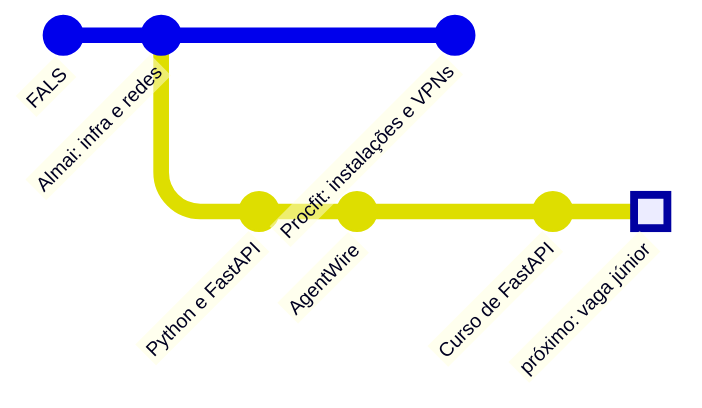
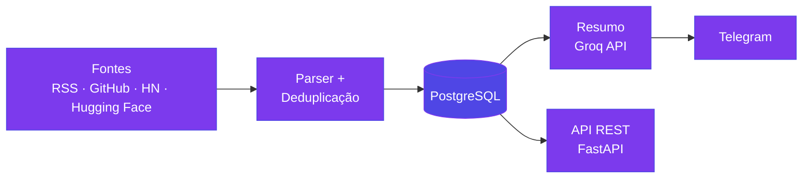

<div align="center">


[LinkedIn](https://www.linkedin.com/in/rafael-maia-508554232) · [GitHub](https://github.com/rafaelmaia-dev) · [AgentWire](https://github.com/rafaelmaia-dev/bot_noticias_ia)

</div>

```bash
$ systemctl status rafael

● rafael.service - desenvolvedor back-end em formação
     Loaded: loaded (FALS · Sistemas de Informação · 6º sem. · dez/2027)
     Active: active (running) · aberto a estágio ou vaga júnior
   Main PID: Procfit · Auxiliar de Instalação (PDV, pré-venda e VPNs)
      Tasks: 1 em desenvolvimento (AgentWire)
     Memory: Python · FastAPI · PostgreSQL · Docker
```

## Sobre

Sou estudante de Sistemas de Informação (6º semestre, FALS) e atuo como **Auxiliar de Instalação na Procfit**, no time de instalações de PDV, pré-venda e VPNs. Antes, fui estagiário de Infraestrutura no Instituto Almai. Foi nesses lugares que aprendi a olhar para o outro lado do software: **onde ele é instalado, em que rede ele roda e o que acontece quando algo para de funcionar.**

Agora levo essa base para o back-end. Trabalho com **Python (FastAPI e Django)**, bancos relacionais (**PostgreSQL e MySQL**) e **Docker, Git e GitHub Actions**, e construo o **AgentWire**, um bot que acompanha as novidades dos agentes de IA.

> [!IMPORTANT]
> **Aberto a oportunidades:** busco estágio ou vaga júnior em desenvolvimento back-end.

## Do cabo ao código

Meu caminho, no formato que eu mais gosto de ler: um `git log`.



## Projeto em destaque: AgentWire

> Bot no Telegram que mantém devs e vibe coders por dentro das novidades dos agentes de IA.


[](https://github.com/rafaelmaia-dev/bot_noticias_ia)

**O problema:** as novidades dos agentes de código (Claude Code, Codex, DeepSeek e outros) saem em blogs, repositórios e redes sociais, e acompanhar tudo toma tempo. O AgentWire coleta, resume e entrega no Telegram, com o link da fonte.

- **Pipeline determinístico.** Cada etapa tem entrada e saída bem definidas, e o LLM é usado só para resumir. Não é um agente de IA: é um sistema auditável *sobre* agentes.
- **API REST (FastAPI) e worker separados**, sobre o mesmo PostgreSQL.
- **Testes automatizados e de regressão**, e Docker para rodar na sua própria máquina.
- Desenvolvido com apoio do Antigravity.



<sub>As fontes além de RSS fazem parte do roadmap do projeto.</sub>

## Stack

| Camada | Ferramentas |
|---|---|
| **Linguagens** |   |
| **Frameworks** |   |
| **Dados** |   |
| **DevOps** |     |
| **Sistemas e redes** |     |
| **Testes** |  |
| **Ferramentas de IA** |   |

Aprofundando agora: SQLAlchemy assíncrono e Alembic, testes com Pytest e CI/CD com GitHub Actions.

## Outros projetos

| Projeto | O que faz | Tecnologia |
|---|---|---|
| [**API Google**](https://github.com/rafaelmaia-dev/api-google) | Script com requisição GET via link, simulando a integração com APIs externas |  |
| [**Calculadora**](https://github.com/rafaelmaia-dev/calculadora-while) | Aplicação de terminal com menu interativo para operações aritméticas, usando `while` |  |

## Formação

<details>
<summary><b>Faculdade e cursos</b></summary>

<br/>

- **FALS** (Faculdade do Litoral Sul Paulista): Sistemas de Informação, 6º semestre, conclusão em dez/2027
- **FastAPI: APIs Modernas e Assíncronas com Python**: Udemy, Geek University, 12,5 horas (concluído em nov/2026)
- **Redes de Computadores com Wireshark** e **Git e GitHub**: Udemy
- **Inglês**: CNA Master in English

</details>

## Contato

Recrutadores e tech leads: o caminho mais rápido é o [**LinkedIn**](https://www.linkedin.com/in/rafael-maia-508554232). Converso por lá sobre back-end, infra e sobre o AgentWire.

<div align="center">


</div>
